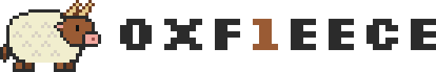
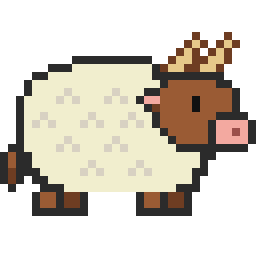

# The oxf1eece logo

<picture>
  <source media="(prefers-color-scheme: dark)" srcset="ox_lockup_dark.svg">
  
</picture>

The name reads two ways, and the logo shows both.

- **"ox fleece"**: an ox wearing a sheep's fleece. The fleece hides the body, but the
  brown head, the horns, the hooves and the tail give the ox away. oxf1eece does the
  same to English words: it dresses them in hexadecimal digits.
- **`0xF1EECE`**: the wordmark is set in [Silkscreen], whose `O` and `0` have
  identical outlines, so `OXF1EECE` also reads as a hex literal. The `1` is the only
  character in the name that is a digit standing in for a letter (`l` → `1`), so it
  alone takes the ox's brown.



All files are transparent. The icon works on light and dark backgrounds as is; the
lockup ships as a light/dark pair (above) because only the wordmark colours change.

## Generate

```sh
uv run logo/gen_logo.py          # icon + light/dark lockups (SVG)
uv run logo/gen_logo.py --png    # also export PNG (needs rsvg-convert)
```

The wordmark glyphs are converted to paths at generation time, so the SVGs render
the same everywhere, with no font installed. The font is bundled in `fonts/` so
every rebuild uses the same glyphs.

## Pixel grid

The sprite is 32×23 pixels, stored as a character grid in `SPRITE` in
`gen_logo.py`. It was made by downsampling a vector draft onto the grid and then
retouching it by hand, so edit the grid directly rather than regenerating it.

The wordmark sits on the same grid: Silkscreen draws on a 125-unit pixel, and one
Silkscreen pixel is set to exactly 2 sprite pixels. Display the assets at integer
multiples of their declared size (README uses `width="552"`, 4 screen px per
sprite pixel) to keep every pixel square.

## Palette

| role                     | hex       |
|--------------------------|-----------|
| outline                  | `#2B2B2B` |
| wool                     | `#F6F3EC` |
| wool curl                | `#D8D1C2` |
| ox brown, accent (light) | `#9A5B34` |
| accent (dark)            | `#C8875A` |
| dark brown               | `#6E3D22` |
| horn                     | `#E6C98A` |
| muzzle, inner ear        | `#F3A9A0` |
| nostril                  | `#9C4F4A` |
| eye                      | `#111111` |

## Font licence

Silkscreen is © 2001 The Silkscreen Project Authors, licensed under the SIL Open
Font License 1.1 (`fonts/OFL.txt`).

[Silkscreen]: https://github.com/googlefonts/silkscreen
